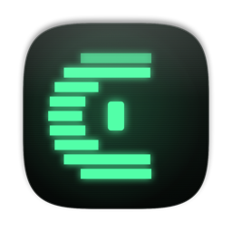
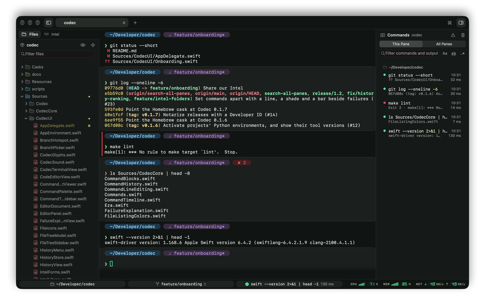
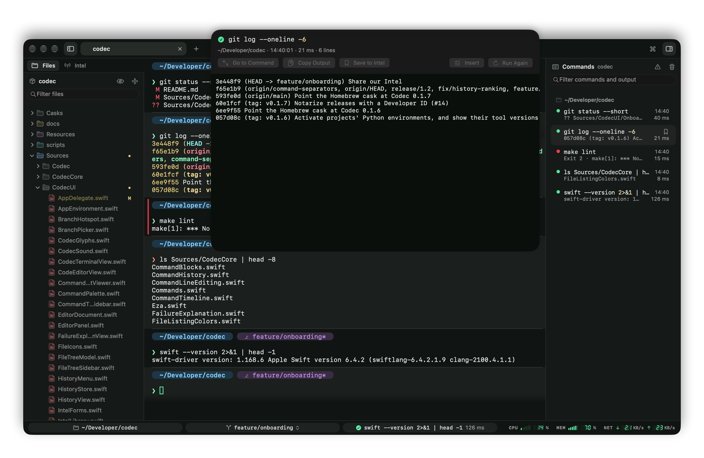
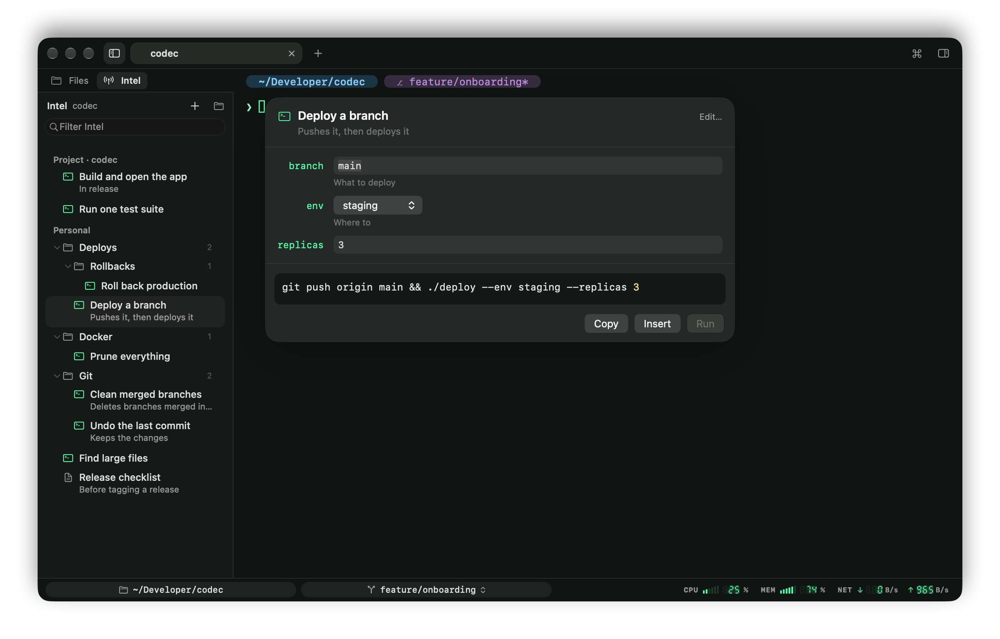
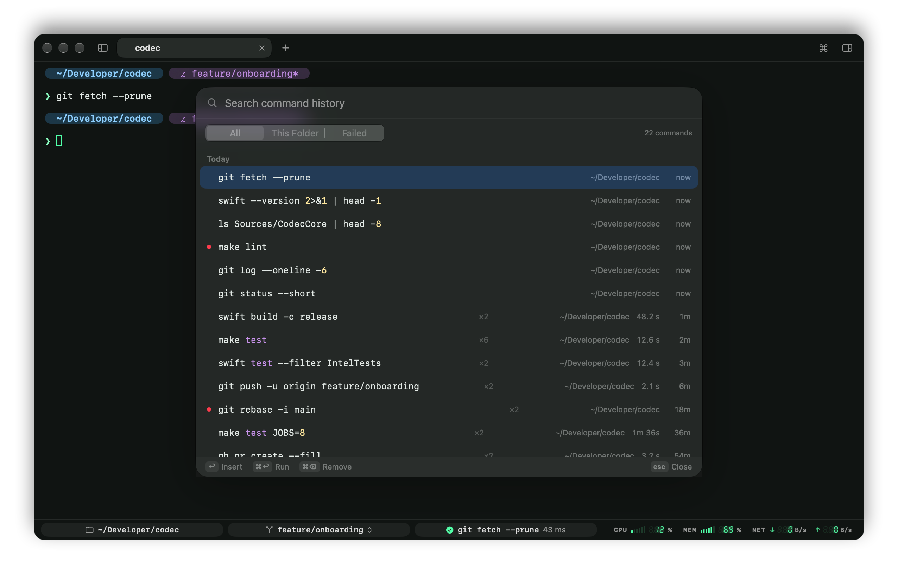
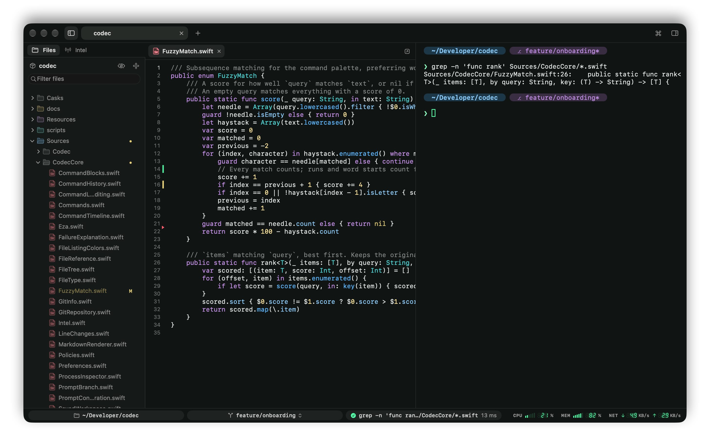
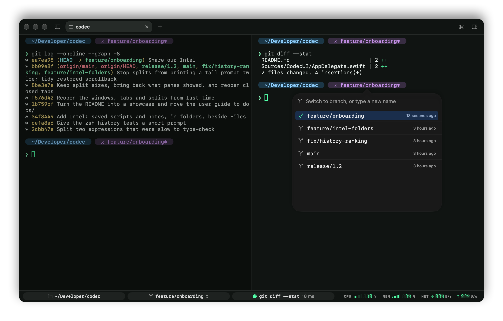
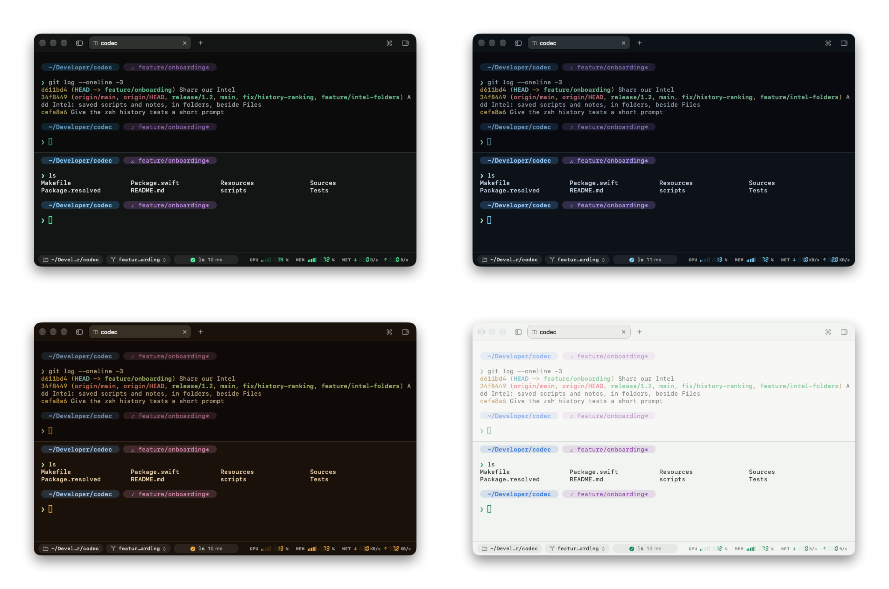

<p align="center">
  
</p>

<h1 align="center">Codec</h1>

<p align="center">
  <strong>A native macOS terminal that remembers what you did.</strong><br>
  Every command and its output, your saved scripts and notes, your files and your history, one keystroke away, in a window of Liquid Glass.
</p>

<p align="center">
  <a href="https://github.com/srozen/codec/actions/workflows/ci.yml"></a>
  
  
</p>

<p align="center">
  
</p>

You ran a dozen things, went on for a while, and now you need to know what that build printed twenty minutes ago. Or you need the command you ran last Tuesday, in another folder, with a different branch. Codec is a terminal built around that moment: it keeps track of what you run, where and how it went, and puts it back in front of you without leaving the keyboard. It's written in Swift for macOS, with AppKit, SwiftUI and SwiftTerm: no Electron, no account, nothing leaves your Mac.

## Every command, remembered



The **Commands sidebar** (⇧⌘L) lists everything the pane ran, under the folder it ran in: whether it worked, how long it took, the last line it printed. Click one and the terminal scrolls back to it and marks it. Open its output in a viewer you can search, copy from, or run again, even after it has scrolled out of the buffer or ⌘K cleared it. Filter by what commands printed, not just what you typed.

→ [Commands sidebar](docs/commands-sidebar.md)

## Intel: the commands you keep coming back to



Save a command with the blanks left in (`{{branch}}`, `{{env}}`) and run it next time from a form with defaults and choice lists. When you save one from the Commands sidebar, Codec spots the parts that tend to change (the branch, paths, URLs, numbers) and offers them as variables, one click each. Keep notes beside them as Markdown documents whose shell blocks you can **▶ Run** from the page.

Intel is plain Markdown in folders: yours in `~/.codec/intel`, and your team's in the repository's `.codec/intel`, committed and shared like the rest of the code.

→ [Intel](docs/intel.md)

## History that knows where you were



↑ at the prompt opens a menu of what you've typed before, filtered as you type. ⌃R or ⌘Y opens the full search: every command with the folder it ran in, how long it took, whether it failed, ranked by how well it matches, then by whether it ran here. As you type, the rest of your last matching command waits dimmed after the cursor; → takes it.

→ [The command line](docs/command-line.md)

## Your project beside the shell



The **file tree** (⇧⌘E) follows you as you `cd`, colors files by git status, and fuzzy-finds any file in the project. Click a file to read it beside the terminal, highlighted in twenty-odd languages; edit it with the keys you'd expect from a code editor. Markdown renders live, with Run buttons on its shell blocks, so a project's README becomes something you can click through.

→ [Files and editor](docs/files-and-editor.md)

## A command line that behaves like a text field

Click anywhere in the command you're typing to put the cursor there, drag to select part of it, double-click a word, ⌘X it. zsh stays the editor underneath, so your completion, key bindings and plugins keep working. Double-click a path with its line number, a URL or a flag with its value to select all of it at once. Tab completion ignores case, matches inside names, and forgives a typo.

## Splits, branches and a prompt you build



Tabs and nested splits in one window. Click the branch in the status bar or in the prompt itself to switch or create branches with a fuzzy search. Build your prompt from chips (directory, branch, changes, duration, exit status, Python environment, Kubernetes context) in a visual editor, or keep your own PS1. Quit and reopen, and your windows, tabs and splits come back, each pane in its folder. Before anything closes, Codec tells you exactly what's still running in it.

→ [Tabs and panes](docs/tabs-and-panes.md) · [Prompt and status bar](docs/prompt-and-status-bar.md)

## Looks the part



Four themes (Codec, Arctic, Amber and Daylight) drawn through everything from the prompt chips to the file icons, with blur, opacity and optional CRT scanlines. The status bar's CPU, memory and network meters rise in codec-style bars and seven-segment digits. When a long command finishes in a pane you're not watching, its tab lights up, you get a notification, and, if you like, the codec calls.

→ [Settings](docs/settings.md)

## Get it

Codec needs **macOS 26** or later. Build it with **Xcode 26** or later:

```bash
git clone https://github.com/srozen/codec.git
cd codec
make run
```

That builds `build/Codec.app` in release and opens it; drag it to Applications to keep it. Most of what's above relies on Codec's zsh integration, which loads automatically, alongside your own `.zshrc`, unchanged.

→ [Getting started](docs/getting-started.md)

## Documentation

| | |
|---|---|
| [Getting started](docs/getting-started.md) | Install, first steps, shell integration, where things are kept |
| [Tabs and panes](docs/tabs-and-panes.md) | Tabs, splits, closing safely, alerts |
| [The command line](docs/command-line.md) | Editing, selection, history, completion, command output |
| [Commands sidebar](docs/commands-sidebar.md) | Going back to earlier commands and their output |
| [Intel](docs/intel.md) | Saved scripts and notes, folders, the file format |
| [Files and editor](docs/files-and-editor.md) | File tree, editor, Markdown |
| [Prompt and status bar](docs/prompt-and-status-bar.md) | Prompt builder, branch switcher, meters |
| [Settings](docs/settings.md) | Themes, fonts, shell, alerts, sounds |
| [Keyboard shortcuts](docs/shortcuts.md) | All of them |
| [Development](docs/development.md) | Architecture, tests, CI, screenshots |

## Built with

[SwiftTerm](https://github.com/migueldeicaza/SwiftTerm) for terminal emulation, and Swift 6 with strict concurrency, AppKit and SwiftUI for everything else. To find your way around the code, see [Development](docs/development.md).
