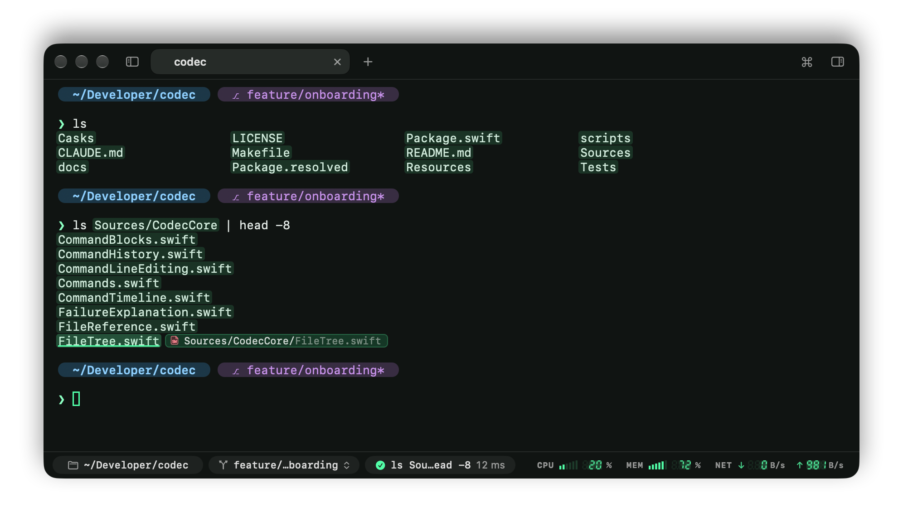
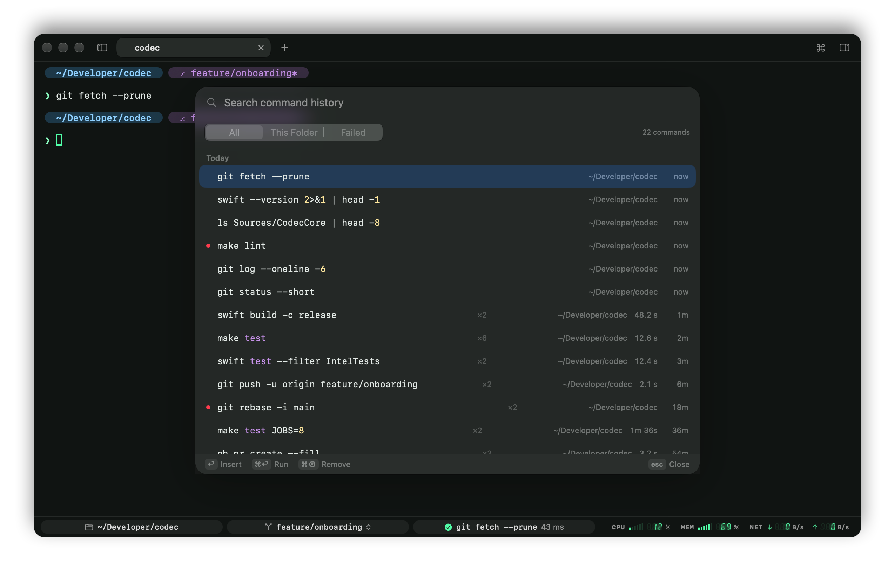

# The command line

Codec keeps zsh as your line editor, so completion, history, key bindings and plugins like zsh-autosuggestions keep working. It adds the mouse and keyboard habits of a text field on top, and a history that remembers where and how each command ran.

## Editing the line like a text field (zsh)

At the prompt, the command you're typing behaves like a text field:

- Click to put the cursor anywhere in it; drag to select part of it; double-click a word, triple-click the whole line.
- Typing replaces the selection; ⌫ and ⌦ delete it; ⌘X cuts it, ⌘C copies it.
- ⇧ with the arrows (and ⌥, Home, End) extends a selection.
- ⌘← / ⌘→ jump to either end of the line, ⇧⌘← / ⇧⌘→ select to them, ⌘⌫ deletes to the start.

zsh's own selection (the region) is what's highlighted, in the theme's selection color.

## Selecting text

- **Double-click** selects a whole token: a path with its line and column (`Sources/App/Main.swift:42:7`), a URL, an email address, an IP and port, a flag with its value. Surrounding brackets, quotes and trailing punctuation are left out.
- **Triple-click** selects the line.
- **⌥-drag** selects a rectangular block.

## Opening files and links

⌘-click a file's name in the output to open it in the [editor](files-and-editor.md#editor), or a folder's to open it in Finder. It works on what `ls` lists, the paths `git status` and `grep` print, and a compiler's `Sources/App/Main.swift:42:7`. Codec looks for the name where the command that printed it ran, then in the folders it was given, so after `ls Sources` its files open too; on the command line you're typing, in the shell's directory. ⌘-click a URL to open it in the browser.

Hold ⌘ to see what opens. Every file and folder name on screen is washed in the theme's accent color, and the one under the pointer is underlined, with a tag showing its icon and, when the name doesn't say it all, the path that opens (`Sources/CodecCore/FileTree.swift` for a name `ls Sources/CodecCore` listed). The marks go as soon as you let go of ⌘. Names that aren't files are left alone, and so is the prompt, whose directory opens from the status bar.

Copy on select is a setting (Settings › Shell › Selection). The scrollback keeps 10,000 lines; ⌘K clears it.

⌘F searches the scrollback. Every match on screen is tinted and the current one is outlined; the bar counts them ("3 of 14"), and marks down the pane's right edge show where the rest are. Return or ⌘G goes to the next match, ⇧Return or ⇧⌘G to the previous one (↓ and ↑ do too), wrapping around; Esc closes the bar. **Aa** matches case, **ab** whole words, **.\*** a regular expression. With text selected, ⌘F (or ⌘E) searches for it. Matches keep up as the pane prints more.

## A command's output (zsh)

Copy or select what a command printed without dragging over it: right-click its output › Copy Output or Select Output, or press ⇧⌘C / ⇧⌘A for the last command. Codec finds a command's output from the command line itself, so it stays right however fast the output scrolled by, and after a resize rewraps the lines.

⌘↑ and ⌘↓ jump between commands in the scrollback. For every command the pane ran, with its output kept even after it leaves the scrollback, open the [Commands sidebar](commands-sidebar.md).

## History as you type (zsh)

As you type, the rest of the most recent matching command appears dimmed after the cursor: → or End takes it, ⌥→ takes its next word. If you use zsh-autosuggestions, it keeps doing this instead.

## History menu

↑ at the prompt opens a menu just above it, filtered by what you've typed, the newest command nearest the prompt:

- ↑ / ↓ to browse, type to narrow it down,
- Return puts the command on the line, ⌘Return runs it.

## History search

⌃R at the prompt, or ⌘Y anywhere, opens the full search: every command, with where it ran, how long it took, when, and whether it failed, grouped by day. Filter it to this folder, or to failed commands.

Matches rank by how well they match (the start of the command, then anywhere in it, then fuzzy), then by whether they ran in this folder, then by how recent they are. Right-click a command to copy it or its folder, or remove it from history (⌘⌫).

Codec keeps its own record in `~/Library/Application Support/Codec/history.jsonl` and includes your zsh history file, so older commands and those from other terminals are there too. Commands typed with a leading space aren't kept. Settings › Shell › History can stop recording, or forget everything recorded so far.

↑ and ⌃R are only taken over where they still do zsh's default (an fzf ⌃R stays fzf's), and multi-line commands keep ↑ for moving between lines. Settings › Shell can turn both off.

## Friendlier Tab completion (zsh)

- Matching ignores case and finds text inside names: `dev` completes `Development`, `notes` completes `my-notes.txt`.
- A typo is forgiven in longer words.
- Ambiguous completions open a menu you can move through with the arrows, in the theme's colors, folders first.

Codec loads zsh's completion system if your `.zshrc` doesn't, and never overrides completion styles you set yourself. Each of these can be turned off in Settings › Shell.
