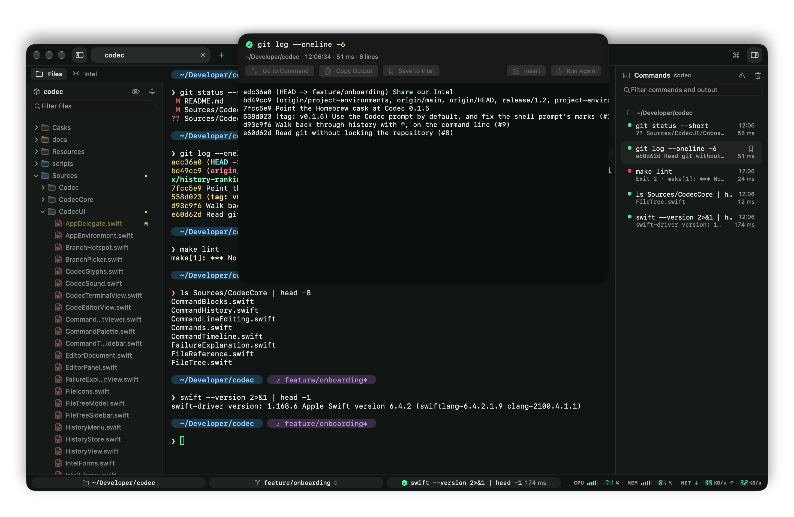
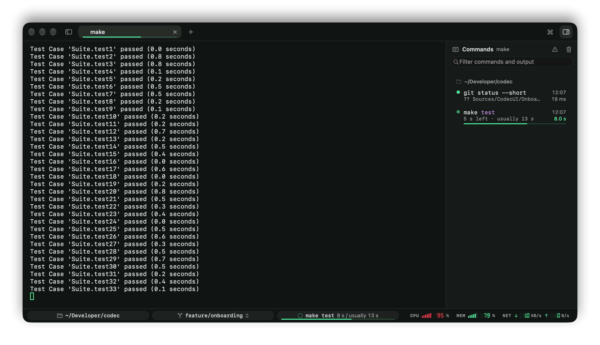

# Commands sidebar (zsh)

You tried a few things, went on for a while, and now you want to see what happened earlier. The Commands sidebar is that pane's story: every command it ran, with how it went and what it printed.

Open it with ⇧⌘L, or the sidebar button at the right end of the tab bar. It follows the focused pane, like the file tree.

## What it shows

Commands are listed oldest first, under the folder they ran in. When a [Python environment or tool versions](prompt-and-status-bar.md#project-environments-zsh) were in effect, the heading shows those too (`py 3.14.6 · ruby 4.0.2`, with `!` after a version that isn't installed), and a new heading starts whenever they change. Each row has:

- a green or red dot for whether it worked (pulsing while it runs),
- when it ran and how long it took,
- the last line it printed (`Build complete!`, `3 tests failed`), or the exit status of a failed one.

## How long it usually takes

Run a command you've run before, and Codec shows how far along it likely is, from how long it took the last few times:

- **The status bar** shows the time so far against the usual time, "42 s / usually 1m 36s", over a thin line that fills as it runs.
- **The tab** gets the same line along its bottom, so you can tell from another tab when a build is about done.
- **The sidebar** shows "54 s left · usually 1m 36s" under the running command.
- Past the usual time, the line and the times turn yellow: "12 s over its usual 1m 36s". Something may be stuck.
- Once it's done, a run that was clearly slower says by how much, in yellow: "2m 10s · 1.6×". Hover the time to see the usual one. The notification for a long command says so too: "Completed after 1m 31s, as usual".

The usual time is the median of the last ten runs that worked, of the exact same command, in the same folder (or anywhere, if it hasn't run there three times yet). Codec leaves a command out when it can't tell:

- it has run fewer than three times, or usually takes under 3 seconds,
- its times are all over the place (`git push`, depending on the network),
- or it never finishes on its own (`npm run dev`, `ssh`, `vim`): runs you stopped with ⌃C, and failed ones, don't count, as they end early.

Turn it off in Settings › Shell › Show how long commands usually take.

## Going back to a command

Click a command, or move through the list with ↑ / ↓: the terminal scrolls back to it and marks it, with a bar beside its rows and a tint on its line. Return goes there and gives the terminal the keyboard; Esc goes back to where you were.

Typing a new command in the terminal never pulls you back to the selected one.

## A command's output

Space or a double-click opens its output in a viewer you can select from and search (⌘F), with Copy Output, Go to Command, Save to Intel, Insert and Run Again.

Codec keeps each command's output when it finishes (its first and last few thousand lines), so it's still there after it has left the scrollback or ⌘K cleared it. Such commands show a small box icon; clicking them opens the viewer.

The list survives quitting Codec: when your windows [come back](tabs-and-panes.md#picking-up-where-you-left-off), each pane's commands come back with them, output included, and you can still go to them in the restored scrollback.

## Why did it fail?

On a Mac with Apple Intelligence, a failed command offers **Explain**: in the status bar, beside its exit status; in its output viewer; or right-click it, in the terminal or in this list, › Explain Failure. The sidebar opens on the command, with the explanation above its output. Apple's on-device model reads the command, its folder, the Python environment and tool versions it ran with, its exit status and the end of its output, plus earlier lines that look like errors, and says in a couple of sentences what went wrong and what to do. Nothing leaves your Mac. It takes a second or two.

When the fix is a command (`git push --set-upstream origin feature/login`, `npm run build`), it's shown with **Insert**, which puts it on the command line for you to check and run. Codec never runs it for you. It's a small model, so it can be wrong.

Turn it off in Settings › Shell › Offer to explain failed commands.

## Filtering

The filter field searches commands and what they printed. A row shows the line that matched, and going to it scrolls to that line. ⚠ shows failed commands only; the bin clears the list (the commands are still tracked, just hidden).

## Right-click

Go to Command, Show Output, Explain Failure (failed commands), Save to Intel…, Copy Command, Copy Output, Select Output, Insert Command, Run Again, Copy Folder Path.

## Saving a command for later

Hover a row and click its bookmark, or right-click › Save to Intel…, to keep the command as an [Intel](intel.md) script. Codec offers the parts that tend to change as variables.
