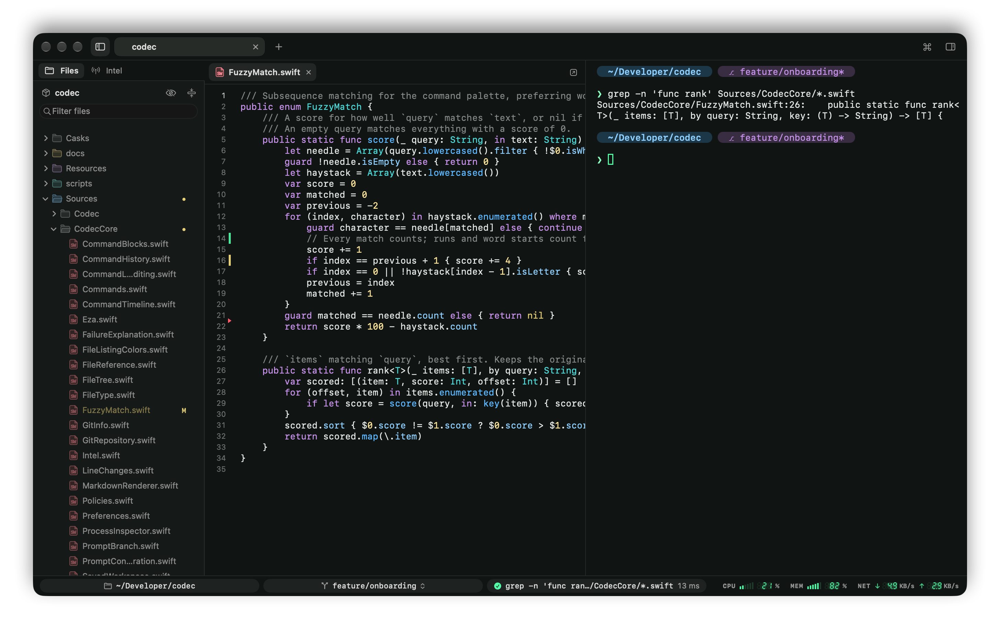

# Files and editor

## File tree

⇧⌘E, or the sidebar button left of the tabs, opens the files of the focused pane's project: its git repository, or its directory outside one.

- It follows the pane as you `cd`, and opens down to the current directory.
- It updates as files change on disk.
- Files are colored by git status (modified, added, untracked, ignored), and folders holding changes get a dot. Codec reads the status without locking the repository, so it never gets in the way of an IDE or git in another terminal.
- Files and folders have Codec's own icons, drawn from the theme's palette: a page with a folded corner and a monogram (SW, TS, PY…) or a glyph per type (a `>_` for scripts, signal bars for audio, a key for `.env`…). Folders are colored by role (sources, tests, docs, assets, scripts), dimmed for build output and dependencies, with the current one in the accent color.
- The eye button shows or hides hidden files.

Type in the filter field to fuzzy-search every file in the project.

Click a folder to open it, click a file to view it in the [editor](#editor). Right-click for Open in Default App, Open in Terminal Editor (`$EDITOR` in a new pane), Change Directory Here, Open in New Tab, Insert Path, Copy Path / Relative Path, Reveal in Finder.

Drag files from the tree, or from Finder, onto a pane to type their quoted paths.

Return opens, ⌘C copies paths, Esc goes back to the terminal. Drag the sidebar's edge to resize it.

The left sidebar has two tabs: Files and [Intel](intel.md).

## Editor

Click a file in the tree to see it beside the terminal, or ⌘-click its name in a pane, wherever `ls`, `git status` or a compiler printed it (see [the command line](command-line.md#opening-files-and-links)). The next click replaces it, as a preview tab (in italics); double-click, press Return, or start typing to keep it in a tab of its own.

Code is colored by Codec's own highlighter, from the theme's palette: Swift, JavaScript and TypeScript, Python, Ruby, Go, Rust, C, C++ and Objective-C, Java, Kotlin, C#, PHP, Lua, SQL, shell scripts and Dockerfiles, JSON, YAML, TOML and INI, HTML and XML, CSS, and Markdown.

Editing works as you'd expect from a code editor:

- line numbers, and the current line highlighted,
- Return keeps the indentation, and adds a level after `{` or `:`,
- Tab and ⇧Tab indent and outdent the selected lines in the file's own style,
- ⌘/ toggles comments, ⌘F finds, undo is per file.

⌘S saves. ⌘W closes the file while the editor has the keyboard (⌥⌘W from anywhere), and Codec asks before throwing away unsaved changes. If a file changes on disk it reloads, or, when you have edits, asks whether to reload or keep yours.

Images and PDFs are shown too; other files offer to open in their app. Drag the editor's edge to resize it.

## Markdown

Markdown opens rendered, styled from the theme, with tables, task lists and colored code blocks. Switch between Source, Split (a live preview beside the source) and Preview with the control in the editor's header; ⇧⌘V switches between the source and the preview.

Links open in the browser; links to other files open in the editor. Shell code blocks get Run and Insert, which act on the focused pane (see [Intel › Documents](intel.md#documents)).
