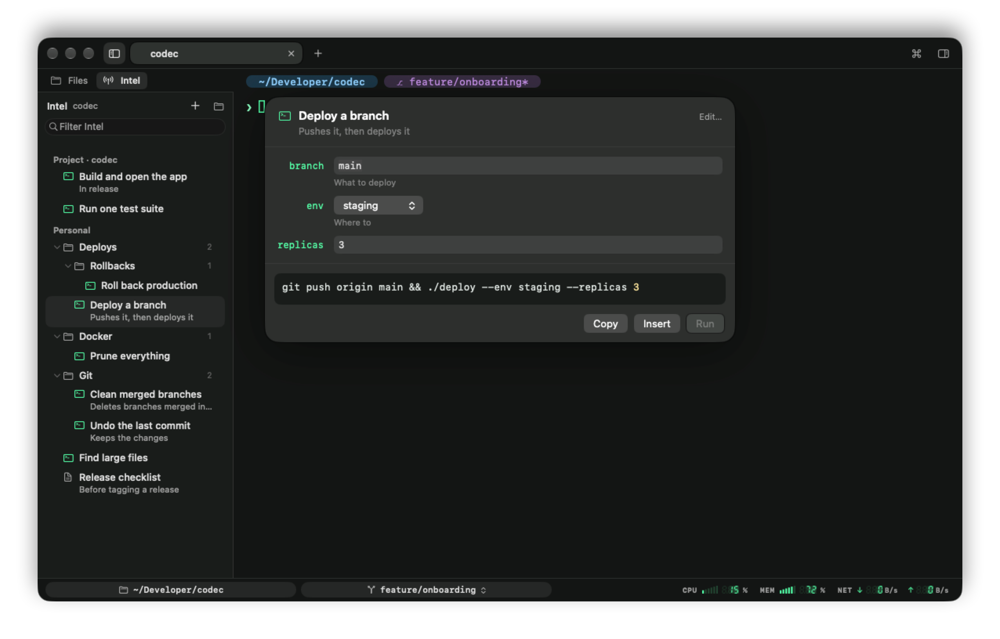
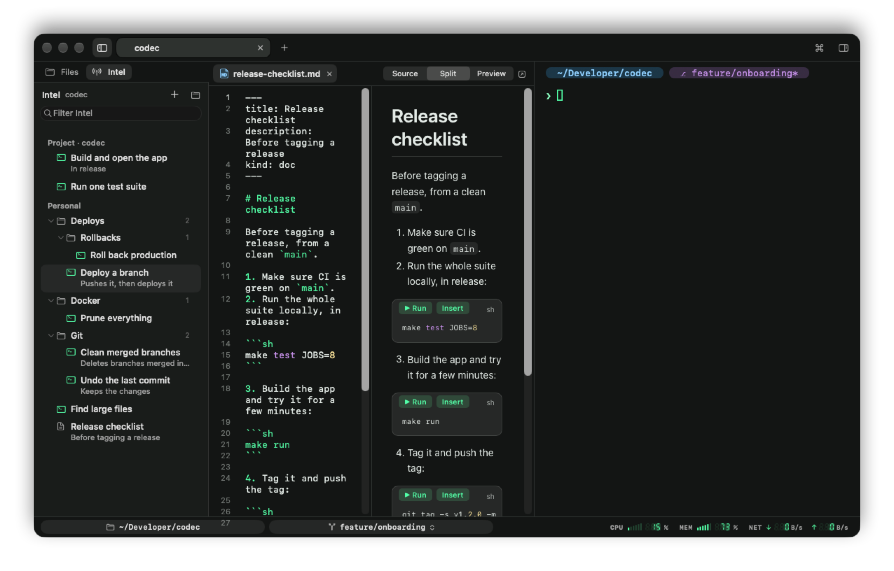

# Intel



Intel is where you keep the commands and notes you come back to: the deploy you run every Friday with a different branch, the one-liner that cleans up Docker, the checklist for a release. It's the Intel tab beside Files in the left sidebar (⇧⌘I).

There are two kinds of items:

- **Scripts**: a command with a title, a description and `{{variables}}` to fill in each time.
- **Documents**: Markdown notes, whose shell code blocks you can run from the page.

## Personal and project Intel

- **Personal** Intel is yours, in `~/.codec/intel`: easy to back up or keep in a dotfiles repository.
- **Project** Intel lives in the repository of the focused pane, in `.codec/intel`, so you can commit it and share it with your team. It shows first, under "Project · name", and follows the focused pane from repository to repository.

## Running a script

Click a script, or pick it in the command palette ("Intel: …"), to open its form:

- each variable gets a field, or a menu when it has a list of choices, with its default filled in;
- the finished command updates as you type;
- **Return** puts it on the command line, to look at or change before running it; **⌘Return** runs it; **Copy** copies it.

## Saving a command

Three ways:

- **From the Commands sidebar**: hover a command and click its bookmark, or right-click › Save to Intel…, or Save to Intel in the output viewer.
- **+ › New Script…** in the Intel tab, or "New Intel Script…" in the command palette.
- **Right-click a folder › New Script Here…**

The form offers the parts of the command that tend to change as variables, one click each: the git branch, paths and file names, URLs, numbers, addresses, quoted text, `--flag=value` values. A variable named after the flag before it (`--env staging` becomes `{{env}}`) when there is one. Type `{{name}}` yourself anywhere in the command for any other.

For each variable, you can add a description, a default and a comma-separated list of choices. Choose Personal or Project, and a folder, then Save (⌘Return).

## Documents

+ › New Document… makes a Markdown document and opens it in the editor, with a live preview beside the source. Click a document in Intel to read it, rendered.



Every shell code block (` ```sh `, `bash`, `zsh`, `shell`, `console`, `fish`, or no language) gets **▶ Run** and **Insert** above it, which act on the focused pane. That's true of every Markdown file you open in Codec, not only Intel documents: a project's README becomes runnable.

## Folders

Keep items in folders and subfolders. Folders are real directories in the Intel folder, so they show up the same in Finder and in git.

- **+ › New Folder** makes one where the selection is. It's named "New Folder" and ready to rename: type a name and press Return (Esc keeps "New Folder").
- **Right-click a folder** for New Script Here…, New Document Here…, New Folder, Rename, Move to Personal / Project, Move Out of its parent, Reveal in Finder, Move to Trash.
- **Right-click the Personal or Project heading** to make something at the top.
- **Drag** an item or a folder onto another folder to move it there, between Personal and Project too. Dropping on an item puts it in that item's folder.
- Click a folder, or use → and ←, to open and close it. Codec remembers which are closed. Each folder shows how many items it holds.
- Filtering opens the folders that hold a match and hides the others.

## Managing items

Right-click an item for:

- **Run… / Copy Command** for a script, **Open** for a document,
- **Edit…** to change its title, description, command and variables,
- **Open File** to edit its Markdown source,
- **Move to Personal / Project**, **Move Out of** its folder,
- **Reveal in Finder**, **Move to Trash**.

The folder button at the top of the tab shows your Intel folder in Finder. Intel rereads its folders when they change on disk, so edits made elsewhere (in your editor, or by `git pull`) show up straight away.

## The file format

Each item is a Markdown file with a small YAML header, so it reads well on GitHub and anywhere else, and can be written by hand.

````markdown
---
title: Deploy a branch
description: Pushes it, then deploys it
kind: script
variables:
  - name: branch
    description: What to deploy
    default: main
  - name: env
    choices: [staging, production]
---

```sh
git push origin {{branch}} && ./deploy --env {{env}}
```
````

| Key | Meaning |
|---|---|
| `title` | The name shown in the list. Without one, the file name is used. |
| `description` | One line shown under the title. Optional. |
| `kind` | `script` or `doc`. Without a header at all, the file is a document. |
| `variables` | For scripts: each one's `name`, and optionally its `description`, `default` and `choices`. |

A script's command is its first shell code block, or the whole body if it has none. Variables are written `{{name}}`: a letter or `_` first, then letters, digits, `_` or `-`. Variables used in the command but not listed in the header still get a field, with no default.

New files are named after their title (`deploy-a-branch.md`).
