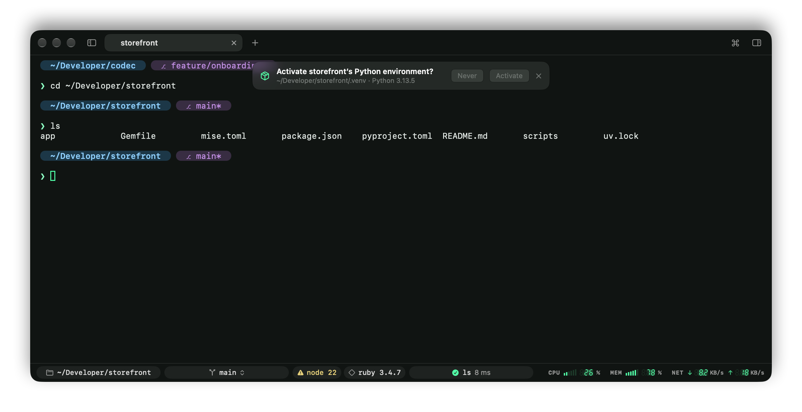

# Prompt and status bar

## The prompt builder

In zsh, Codec draws its own prompt by default, built from chips. Settings › Prompt › Edit Prompt… lets you change it, or go back to your shell's own prompt (PS1), themes such as Oh My Zsh or Powerlevel10k included:

- **Add** a chip by clicking or dragging it in; **drag** to reorder; **×** to remove; **right-click** to recolor.
- **Chips**: working directory, git branch (with `*` for uncommitted changes), git changes (`3 • +10 -2`), Python environment, Kubernetes context, the last command's duration and exit status, background jobs, user@host, time and date.
- **Style**: by default, segments are drawn as chips (tinted, rounded pills like the ones in Codec's status bar, colored from your theme, with the directory in bold). The Text style draws them as a phrase instead: `~/code/codec on main* via venv took 3.2s`. The Panel style draws them like a codec screen: one bracketed panel, each segment behind a short tag in a dimmer shade of its color (`LOC`, `BR`, `T+`, `EXIT`), segments split by bars, and readings such as the duration, exit status and time in LCD digits. Codec draws the digits and the panel's corners itself, so they look the same in any font.
- **Layout**: one line, or the context on a line above the command.
- **Symbol**: the character before the command, which turns red after a failed command.

Changes apply to open zsh panes at their next prompt. Values that come from the shell (branch names and the like) are escaped, so they can't run code even with `prompt_subst` on.

## Branch switcher

Click the branch in the status bar, or in the prompt itself (it works for your own PS1 too, wherever it shows the branch), or press ⇧⌘B:

- fuzzy-search local branches, most recent first, and remote ones, which become tracking branches,
- type a new name to create a branch.

If git refuses, say because uncommitted changes would be overwritten, its explanation shows in the popover. The prompt and status bar update straight away.

## Status bar (zsh)

Along the bottom of the window:

- the **directory**: click to open it in Finder,
- the **git branch**: click to switch,
- the **Python environment and tool versions** in effect, when there are any: click them for where each comes from ([below](#project-environments-zsh)),
- the **running or last command**, with its exit status and how long it took; while a command you've run before is running, how far along it likely is ([how long it usually takes](commands-sidebar.md#how-long-it-usually-takes)). After a failure, **Explain** asks Apple Intelligence [why it failed](commands-sidebar.md#why-did-it-fail).

## Project environments (zsh)

Codec keeps track of the Python virtual environment and the tool versions each pane's shell is using.

**Virtual environments.** When you go into a folder with a `.venv` (as `uv venv`, `uv sync` or `python -m venv .venv` make it), or any folder below one, a question shows at the top of the pane: **Activate** it, **Never**, or **×** for not now. Codec remembers the answer for that environment, in every pane. Once you've allowed it, Codec activates it as you go in and deactivates it as you leave, the way `source .venv/bin/activate` and `deactivate` would, with nothing to type. It's active by the time the `cd` returns, so `cd app && python main.py` uses it. A folder you downloaded could ship its own `.venv/bin/python`, which is why Codec asks first.

- `deactivate` works as usual, and the environment stays off until you leave the project.
- An environment you activate yourself, or that mise activates (`_.python.venv`), is left alone.
- Codec never creates environments or installs anything; run `uv sync` for that, and Codec asks about the new `.venv` at the next prompt.
- Turn it off in Settings › Shell › Project environments, which also has **Forget My Answers**.

**Tool versions.** If [mise](https://mise.jdx.dev) is active in your shell (`mise activate` in your `.zshrc`, or its shims on your `PATH`), the status bar shows the version of each tool it picked: `ruby 4.0.2`, `node 24.12.0`. Python shows its environment's version and project name. Click them for a popover with where each version comes from (`mise.toml`, `.tool-versions`, `.ruby-version`, or your global `~/.config/mise/config.toml`) and each environment's path. A version a project asks for that isn't installed gets a warning sign; mise runs another version, or none, in its place. **Install with mise** runs `mise install` in the pane.

Codec checks again whenever you change folders, run `mise` or `uv`, or mise changes what's on the `PATH`. Each command in the [Commands sidebar](commands-sidebar.md) records what it ran with, and [Explain](commands-sidebar.md#why-did-it-fail) passes it along: "wrong Ruby" is a common reason for a failure.

## System meters

The right end of the status bar shows CPU, memory and network as codec-style rising bars and seven-segment readouts; bars turn red above 85 %. Click them to open Activity Monitor. Hide them in Settings › Appearance › Status bar.
