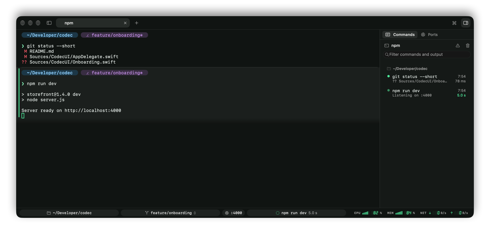
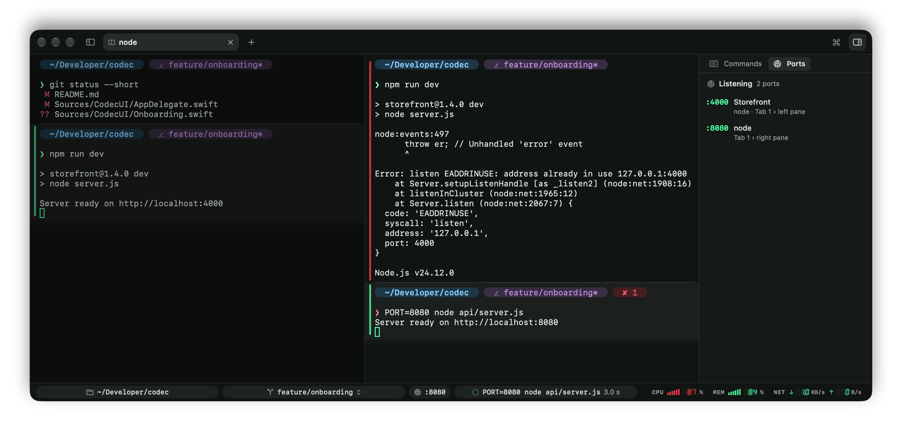
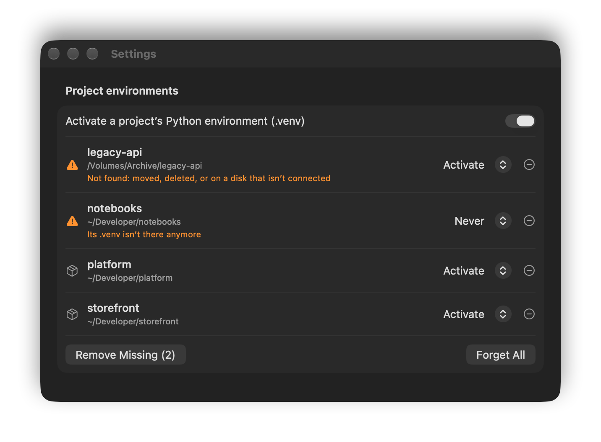
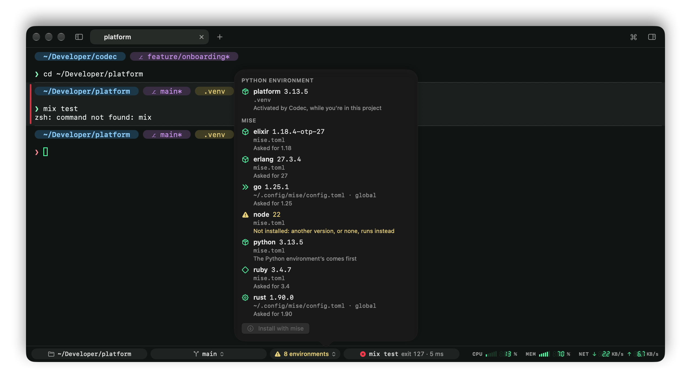

# Prompt and status bar

## The prompt builder

In zsh, Codec draws its own prompt by default, built from chips. Settings › Prompt › Edit Prompt… lets you change it, or go back to your shell's own prompt (PS1), themes such as Oh My Zsh or Powerlevel10k included:

- **Add** a chip by clicking or dragging it in; **drag** to reorder; **×** to remove; **right-click** to recolor.
- **Chips**: working directory, git branch (with `*` for uncommitted changes), git changes (`3 • +10 -2`), Python environment, Kubernetes context, the last command's duration and exit status, background jobs, user@host, time and date.
- **Style**: by default, segments are drawn as chips (tinted, rounded pills like the ones in Codec's status bar, colored from your theme, with the directory in bold). The Text style draws them as a phrase instead: `~/code/codec on main* via venv took 3.2s`. The Panel style draws them like a codec screen: one bracketed panel, each segment behind a short tag in a dimmer shade of its color (`LOC`, `BR`, `T+`, `EXIT`), segments split by bars, and readings such as the duration, exit status and time in LCD digits. Codec draws the digits and the panel's corners itself, so they look the same in any font.
- **Layout**: one line, or the context on a line above the command.
- **Symbol**: the character before the command, which turns red after a failed command.

Changes apply to open zsh panes at their next prompt. Values that come from the shell (branch names and the like) are escaped, so they can't run code even with `prompt_subst` on.

## Branch switcher

Click the branch in the status bar, or in the prompt itself (it works for your own PS1 too, wherever it shows the branch), or press ⇧⌘B:

- fuzzy-search local branches, most recent first, and remote ones, which become tracking branches,
- type a new name to create a branch.

If git refuses, say because uncommitted changes would be overwritten, its explanation shows in the popover. The prompt and status bar update straight away.

## Status bar (zsh)

Along the bottom of the window:

- the **directory**: click to open it in Finder,
- the **git branch**: click to switch,
- **how many environments** are in effect (the Python environment and each tool version), when there are any: click it for the list, with where each comes from ([below](#project-environments-zsh)),
- the **ports** the pane's programs are listening on (`:3000`), when there are any: click to open one in the browser ([below](#listening-ports)),
- the **running or last command**, with its exit status and how long it took; while a command you've run before is running, how far along it likely is ([how long it usually takes](commands-sidebar.md#how-long-it-usually-takes)). After a failure, **Explain** asks Apple Intelligence [why it failed](commands-sidebar.md#why-did-it-fail).

## Listening ports

Every dev server prints its address differently, and you scroll back to find it. Codec asks macOS instead: when a program started from the pane listens on a TCP port, the port shows in the status bar.

- **Click it** to open `http://localhost:3000` in the browser. If the program printed an address for that port as it started (`Local: https://localhost:3000/app`), that's what opens, scheme and path included; an address for every interface (`http://0.0.0.0:8000`) opens as `localhost`.
- **Several ports** (`:3000 :9229`) make a menu, each with its address and the program holding it.
- It counts whatever the pane's shell started, however far down: `npm run dev` runs a shell that runs Node, and it's Node's port that shows. Jobs in the background count too. A server that detaches itself from the terminal (a daemon) doesn't.
- The port goes when the program stops listening.

### Every port in one place

The status bar shows the focused pane's ports. For all of them, open the **Ports** tab of the right sidebar, beside [Commands](commands-sidebar.md): ⇧⌘O or View › Listening Ports. The sidebar button at the right end of the tab bar brings the sidebar back on the tab it was last on.

It lists every port the programs in any pane are listening on, with the program and where its pane is, this window's first and other windows' under their names. It keeps up as servers start and stop, and as tabs and panes move.

- **Click a port** to go straight to its pane, in whichever tab or window it is.
- **Hover it** for two buttons: the compass opens it in the browser, the pencil names it. Right-click has the same, and Copy Address.
- **Name a process** to tell servers apart when they're all "node": click the pencil, type "Storefront", press Return. The name stands in for the program wherever the port shows (this list, the status bar's tooltips and menu, the tab's tooltip, Window › Listening Ports, the command palette, and the line about a [port already in use](commands-sidebar.md#port-already-in-use)), on every port the process has. It lasts as long as the process: a server that's restarted is a new process and goes by its program's name again. Clear the name, or right-click › Remove Name, to take it away.

**Window › Listening Ports** has the same list as a menu (`:3000  Storefront — Tab 2 › left pane`), under each window's name when more than one has ports. Choose a port to go to its pane; hold ⌥ and the item opens the port in the browser instead. The [command palette](tabs-and-panes.md#the-command-palette) (⇧⌘P) has both too: type the port or the name, then pick "Go to :3000 — Storefront, Tab 2 › left pane" or "Open http://localhost:3000 in the Browser".

The same ports show in the [Commands sidebar](commands-sidebar.md#what-it-shows) on the running command's row, in the tab's tooltip, and in the question Codec asks [before closing](tabs-and-panes.md#closing-safely) something that's still running. And when another command finds one of them taken, Codec [says which pane has it](commands-sidebar.md#port-already-in-use).

Codec looks a couple of seconds after a command starts, whenever something is printed, and every few seconds otherwise, by asking the kernel about the processes under the pane's shell. It runs nothing (no `lsof`), and works in any shell, with or without Codec's integration.

## Project environments (zsh)

Codec keeps track of the Python environment and the tool versions each pane's shell is using.

**Virtual environments.** When you go into a folder with a `.venv` (as `uv venv`, `uv sync` or `python -m venv .venv` make it), or any folder below one, a question shows at the top of the pane:

- **Always**: activate it now and whenever you're in the project, in every pane. Codec remembers it.
- **This Time**: activate it in this pane until you leave the project. Nothing is remembered, so the next visit asks again.
- **Never**: don't, and don't ask again. Codec remembers it.
- **×**: not now. This pane won't ask about it again; other panes still do.

An answer is for that environment's path, so another clone or worktree of the project is asked about on its own. Once you've allowed it, Codec activates it as you go in and deactivates it as you leave, the way `source .venv/bin/activate` and `deactivate` would, with nothing to type. It's active by the time the `cd` returns, so `cd app && python main.py` uses it. A folder you downloaded could ship its own `.venv/bin/python`, which is why Codec asks first.

- `deactivate` works as usual, and the environment stays off until you leave the project.
- An environment you activate yourself, or that mise activates (`_.python.venv`), is left alone.
- Codec never creates environments or installs anything; run `uv sync` for that, and Codec asks about the new `.venv` at the next prompt.
- Settings › Shell › Project environments lists your answers, a project per row: switch one between Activate and Never, or forget it so Codec asks again. Panes already in the project take the change at their prompt. A project whose folder or `.venv` can't be found is flagged (it may have moved, or be on a disk that isn't connected), and **Remove Missing** forgets those; Codec never removes them by itself. The same section turns activation off.

**Tool versions.** Codec also follows which version of each tool your version manager picked for the folder (`ruby 4.0.2`, `node 24.12.0`). The status bar counts them, with the Python environment, in one chip (`8 environments`), so a project with many tools doesn't crowd out the folder and the command; it turns to a warning when one needs attention. Click it for the list: each environment's name, version and path, and where each version comes from.

- **mise**, when it's active in your shell (`mise activate` in your `.zshrc`, or its shims on your `PATH`): Codec asks it what it picked, which covers every file it reads (`mise.toml`, `.tool-versions`, `.python-version`…).
- Otherwise, Codec reads the files and variables of the managers your shell has, without running them: **pyenv**, **rbenv** and **nodenv** (`.python-version`, `.ruby-version`, `.node-version`, then their global version), **asdf** (`.tool-versions`, the nearest that names each tool), **nvm** and **fnm** (`.nvmrc`, `.node-version`), and **chruby** (`.ruby-version`).
- **Conda**: the active environment's name and Python version, unless it's `base`, which conda activates everywhere by default. A virtual environment, when one is active, comes first.

A version a project asks for that isn't installed gets a warning sign: another version, or none, runs in its place. So does a Node or Ruby that nvm, fnm or chruby put on the `PATH` when the project asks for another, since they switch only when told. The popover offers the fix and runs it in the pane: **Install with mise** (`mise install`, `pyenv install 3.12`…) or **Switch with nvm** (`nvm use`, `fnm use`, `chruby 3.2`).

Codec checks again whenever you change folders, run one of these tools (`mise`, `uv`, `pyenv`, `nvm`, `conda`…), or mise changes what's on the `PATH`. Each command in the [Commands sidebar](commands-sidebar.md) records what it ran with, and [Explain](commands-sidebar.md#why-did-it-fail) passes it along: "wrong Ruby" is a common reason for a failure.

## System meters

The right end of the status bar shows CPU, memory and network as codec-style rising bars and seven-segment readouts; bars turn red above 85 %. Click them to open Activity Monitor. Hide them in Settings › Appearance › Status bar.
