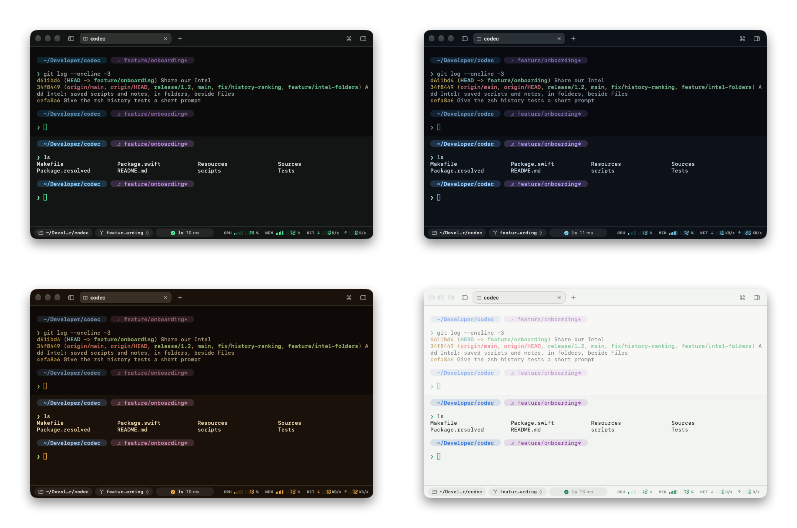

# Settings

Open Settings with ⌘,. Changes apply as you make them, unless a setting says it applies to new panes.

## Appearance

- **Theme**: Codec (green on black, after the codec screen), Arctic, Amber and Daylight. Also in the command palette.
- **Text**: the font (SF Mono by default, or any monospaced font you have) and its size, 9 to 24 points. ⌘+ / ⌘− / ⌘0 change the size from anywhere.
- **Window**: blur behind the window, its opacity, dimming inactive split panes, CRT scanlines, and whether Codec [reopens your windows and tabs](tabs-and-panes.md#picking-up-where-you-left-off) at launch, with what each pane showed and its commands.
- **Status bar**: show or hide the CPU, memory and network meters.

## Shell

- **Shell**: the program panes run (your login shell by default), and whether Option acts as Meta.
- **Shell integration**: what makes the zsh features work. See [Getting started › Shell integration](getting-started.md#shell-integration-zsh).
- **Command line**: suggestions from history as you type, ↑ and ⌃R for the history menu and search, friendlier Tab completion. These apply to new panes; your `.zshrc` settings win.
- **History**: whether Codec records the commands you run, and a button to forget everything recorded so far. Forgetting also hides older commands from your shell's history file in Codec, without changing the file.
- **Selection**: copy text as soon as it's selected.

## Prompt

Your shell's prompt, or the Codec prompt and its builder. See [Prompt and status bar](prompt-and-status-bar.md).

## Alerts

- **When the shell exits**: close the pane unless the shell crashed (the default), always close it, or always keep it open.
- **Bell**: in the focused pane, visual only, visual plus a codec lock-on, visual plus the system alert, or nothing. And whether panes you're not looking at notify you of a bell or of a command that ran for more than 10 seconds.
- **Codec sounds**: on or off, also when opening and closing panes, and their volume, with buttons to hear each one.
