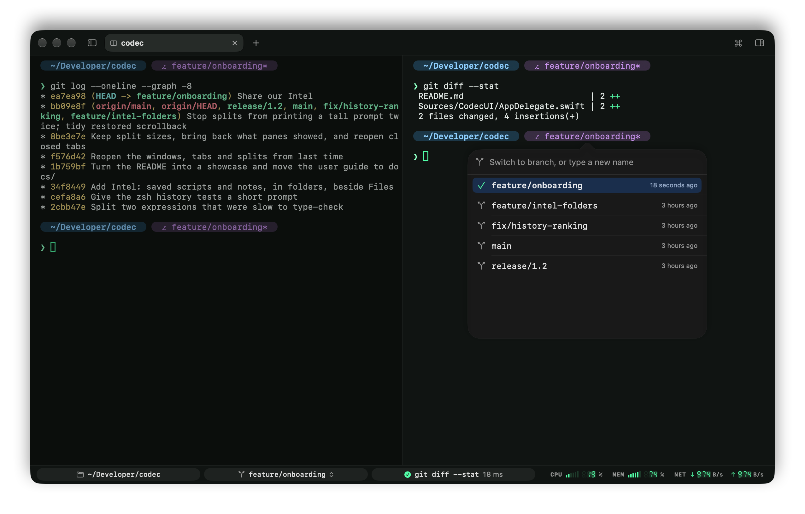

# Tabs and panes

## Tabs

Tabs live in the title bar. ⌘T opens one in the current directory; ⌘1…⌘9 go to a tab, ⇧⌘] / ⇧⌘[ or ⌃⇥ move between them.

A tab is titled after what's running in it. To name it yourself, double-click it, right-click › Rename Tab…, or press ⇧⌘R. Clear the name to go back to the automatic title.

Drag a tab along the tab bar to put it elsewhere; ⌘1…⌘9 follow the new order, and so does the window when Codec reopens it. Middle-click a tab to close it.

## Splits

Split any pane right (⌘D) or down (⇧⌘D), left (⌃⌘←) or up (⌃⌘↑); ⌃⌘→ and ⌃⌘↓ split right and down too. The new pane opens in the same directory. Splits nest as deep as you like.

- ⌘] / ⌘[ go to the next or previous pane, ⌥⌘ with an arrow to the pane in that direction.
- Inactive panes dim, so you always know which one has the keyboard (Settings › Appearance › Dim inactive split panes).
- Drag the line between two panes to resize them. Each split keeps its sizes when you switch tabs, when panes are added or closed (a new pane takes half of the one it split from), and when Codec reopens it.

## Picking up where you left off

Quit Codec and open it again, and your windows come back as you left them: each with its tabs in order, their names, their splits at their sizes, which tab and pane had focus, and every pane in the folder it was in. If a folder has gone since, the pane opens in the nearest one that's left.

Each pane also shows what it showed when you quit, in its colors, under a "Restored" line, and its [Commands sidebar](commands-sidebar.md) still lists the commands it ran, with their output: yesterday's build output is still there. The programs that were running don't come back: each pane starts a fresh shell below.

Closing a window yourself forgets it; quitting keeps everything that's open. Codec saves the windows as you go, so they come back even if it didn't get to quit normally; what panes showed is kept when you quit.

Settings › Appearance › Window turns both off: Reopen windows and tabs from last time, and With what each pane showed, and its commands. What panes showed is kept in `~/Library/Application Support/Codec/Saved Panes`, readable only by you, and deleted once it's been shown again.

## Reopening a closed tab

Closed a tab by mistake? ⇧⌘T (Shell › Reopen Closed Tab) brings it back, after the current tab: its splits, folders and name, and what its panes showed. It works for the last ten tabs you closed, including the tabs of a window you closed, while Codec is open.

## Closing safely

Before a tab, a pane or a window closes, or Codec quits, it checks whether that would end something still running, in the foreground or in the background (`npm run dev &` counts; the shell's own helpers don't), and names what would be terminated before asking.

## When something needs you

A bell, or a command that ran longer than 10 seconds finishing, in a pane you aren't looking at:

- marks its tab,
- badges the Dock icon,
- posts a notification (click it to go there),
- plays the codec call, if sounds are on.

In the focused pane, the bell shows a small "!" at the cursor. What the bell does is up to you in [Settings › Alerts](settings.md#alerts).

## When the shell exits

A clean `exit` closes the pane. If the shell crashes or is killed, the pane stays, with a banner: Return restarts the shell, Esc closes the pane. Settings › Alerts › When the shell exits can always close the pane or always keep it instead.

## Right-click menu

Right-click in a pane for Copy, Copy Output, Select Output, Paste, Select All, Split Left / Right / Up / Down, Find, Clear Buffer, Restart Shell, Open in Finder, Copy Path, Switch Branch…, Close Pane. Programs that use the mouse (vim, htop, tmux) still get their right-clicks.

## The command palette

⇧⌘P, or the ⌘ button at the right of the tab bar, opens the command palette: every action, theme, open tab and [Intel](intel.md) item, fuzzy-searched.
